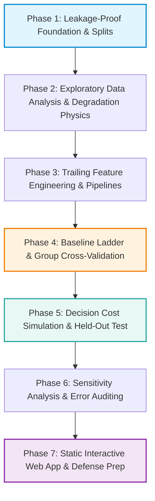

# Project Development Roadmap: Predictive Maintenance on NASA C-MAPSS (ES 335)

This roadmap outlines the 7-phase execution plan for the **ES 335 Machine Learning (2026)** course project. It satisfies every criterion of the 100-point rubric with zero data leakage, a clean 6-rung baseline ladder, decision-centric evaluation, and a static interactive web deliverable for GitHub Pages.

---

---

## Phase 1: Leakage-Proof Data Foundation & Split Protocol

> **Objective:** Fix the experimental split before any data analysis or modeling, establishing a strict integrity boundary between development and test engines.

### 1. Key Tasks
- **Engine-Level Split:** Split the 100 run-to-failure training engines from `CMAPSSData/train_FD001.txt` into:
  - **80 Development Engines** (used for EDA, sensor screening, feature design, and 5-fold `GroupKFold` CV).
  - **20 Held-Out Test Engines** (sealed until Phase 5; evaluated once for final metrics and policy simulation).
- **Split Persistence:** Save engine ID lists and fold definitions to `data/splits/` using fixed seed `42`.
- **Target Formulation:**
  - *Piecewise Linear RUL Target:* Capped at $RUL_{\text{max}} = 125$ cycles (initial cycles exhibit zero discernible wear).
  - *Binary Alarm Target:* $A_t = \mathbb{I}(\text{RUL}_t \le w)$ with default lead time $w = 30$ cycles.
- **Data Ingestion Module:** `src/data.py` standardizes loading, target attachment, and dev/test boundary enforcement.

### 2. Deliverables & Outputs
- `src/data.py`
- `scripts/verify_data.py`, `scripts/make_splits.py`
- `data/splits/dev_engines.json`, `data/splits/test_engines.json`, `data/splits/split_summary.json`

---

## Phase 2: Exploratory Data Analysis & Degradation Physics

> **Objective:** Screen uninformative channels strictly on the 80 development engines, examine fleet lifetime spread, align degradation curves before failure, and construct an unsupervised 1D PCA health index.

### 1. Key Tasks
- **Sensor & Setting Variance Screening:** Evaluate all 3 operating settings and 21 sensors **strictly on the 80 development engines**, dropping the 3 fixed sea-level settings and 7 constant/near-constant sensors (`sensor_1, 5, 6, 10, 16, 18, 19`) to retain **14 degradation sensors**.
- **Fleet Lifetime Distribution:** Inspect the 128–362 cycle lifespan spread (median 199 cycles) showing why any single fixed replacement schedule fails to balance early failures against wasted useful life.
- **Trajectory Alignment Analysis:** Compare raw forward-time sensor readings ($t$) against failure-aligned readings ($t - T_{\text{failure}}$), exposing the degradation onset near $-125$ cycles.
- **Sensor Correlation & Unsupervised Health Index:** Compute the 14-sensor correlation matrix and fit a 1D PCA Composite Health Index (PC1).

### 2. Deliverables & Outputs
- `src/eda.py`, `scripts/run_eda.py`
- `notebooks/01_eda_and_features.ipynb`
- `results/metrics/eda_sensor_screening.csv`
- `results/figures/engine_lifetime_distribution.png`
- `results/figures/sensor_trajectories_aligned.png`
- `results/figures/sensor_correlation_and_pca_health_index.png`

---

## Phase 3: Trailing-Window Feature Engineering & Pipelines

> **Objective:** Engineer strictly causal, per-engine trailing temporal features inside a `Pipeline` fitted only on training folds.

### 1. Key Tasks
- **Strict Trailing Temporal Features:**
  - Primary trailing window length $k = 30$ cycles ($[t-k+1, t]$ grouped per engine via `unit_id`; $k = 10$ evaluated in Phase 6 sensitivity).
  - Features per retained sensor: **Rolling Mean** (smoothed level), **Linear Drift Slope** (degradation rate $\frac{\Delta s}{\Delta t}$), and **Rolling Std** (signal instability), plus engine age (`cycle`) $\rightarrow$ **43 features**.
  - Boundary handling: Expanding causal windows for cycles $t < k$ with variance-stabilized slope denominators.
- **scikit-learn Pipeline Encapsulation:** `SensorVarianceFilter` $\rightarrow$ `TrailingWindowFeatureTransformer` $\rightarrow$ `DataFrameStandardScaler` in `src/features.py`.
- **Integrity Unit Tests:** Verify strict causality (perturbing cycles $> t$ leaves features at $\le t$ unchanged), zero cross-engine bleed, and zero NaNs across 5-fold `GroupKFold`.

### 2. Deliverables & Outputs
- `src/features.py`, `scripts/run_features.py`
- `notebooks/01_eda_and_features.ipynb`
- `data/processed/feature_metadata.json`
- `results/figures/trailing_window_features.png`

---

## Phase 4: Baseline Ladder & Group Cross-Validation

> **Objective:** Evaluate a crisp 6-rung baseline ladder using 5-fold `GroupKFold` cross-validation on the 80 development engines.

### 1. Streamlined Model Ladder ($k = 30$ for Trailing Trends)

| Rung | Regression Models (Continuous RUL) | Classification / Policy Models (Alarm $w=30$) | Role |
| :---: | :--- | :--- | :--- |
| **0** | Mean RUL (`DummyRegressor`) | Never Alarm (`DummyClassifier`) | Floor baseline (zero learning) |
| **1** | — | Fixed Replacement at $K^*$ cycles | Non-sensor schedule baseline |
| **2** | Age-Only Linear (`Ridge`) | Age-Only Logistic Regression | Value of sensor data beyond age |
| **3** | Instantaneous Sensors (`Ridge`, `Lasso`) | Instantaneous Sensors Logistic | Value of raw sensors without trends |
| **4** | Trailing Trends (`Ridge`, `Lasso`) | Trailing Trends Logistic (L2) | Value of causal trailing trends & L1 sparsity |
| **5** | Trailing Trends (`RandomForest`, `HistGradientBoosting`) | Trailing Trends (`RandomForest`, `HistGradientBoosting`) | Nonlinear sensor interactions |

### 2. Key Tasks
- **5-Fold `GroupKFold` Evaluation:** Grouped by `unit_id` on the 80 development engines.
- **Metrics:** Regression (RMSE, MAE, $R^2$, NASA Asymmetric Score); Classification (PR-AUC, ROC-AUC, Brier Score, Reliability Calibration Curves).
- **Cost-Optimal Threshold Locking:** Optimize fixed $K^*_{\text{dev}}$, classifier probability thresholds $p^*_{\text{dev}}$, and regressor RUL triggers $\tau^*_{\text{dev}}$ strictly on development out-of-fold predictions.

### 3. Deliverables & Outputs
- `src/models.py`, `src/plotting.py`, `scripts/run_phase4_cv.py`
- `notebooks/02_modeling_and_evaluation.ipynb`
- `results/metrics/cv_regression_ladder.csv`, `results/metrics/cv_classification_ladder.csv`, `results/metrics/cv_feature_attribution.csv`
- `results/figures/cv_baseline_ladder_progression.png`, `results/figures/cv_pr_and_calibration_curves.png`

---

## Phase 5: Decision-Centric Cost Policy Simulation & Held-Out Test

> **Objective:** Unseal the 20 held-out test engines once to evaluate locked models and thresholds against the fixed replacement schedule, quantify bootstrap uncertainty, and demonstrate row-split leakage.

### 1. Key Tasks
- **Locked Held-Out Test Evaluation:** Apply models trained on all 80 dev engines with dev-locked thresholds ($K^*_{\text{dev}}$, $p^*_{\text{dev}}$, $\tau^*_{\text{dev}}$) once to the 20 test engines.
- **Cost Policy Simulation & Break-Even Sweep:**
  - Cost accounting per engine: $c_{\text{fail}}$ if failure occurs before alarm/replacement; $c_{\text{waste}} \times \text{remaining cycles}$ otherwise.
  - Sweep cost ratios $\frac{c_{\text{fail}}}{c_{\text{waste}}} \in \{10, 20, 30, 50, 75, 100, 150, 200, 300\}$ and locate break-even ratios against Fixed Schedule $K^*_{\text{dev}}$.
- **Engine-Level Bootstrap CIs:** 1,000 engine-level bootstrap resamples over the 20 test engines for test metrics and paired cost savings.
- **Secondary Sanity Check:** Evaluate final-cycle predictions on the 100 official truncated `test_FD001.txt` engines against `RUL_FD001.txt`.
- **Leakage Experiment:** Compare the actual trailing-trend ladder models (`Ridge`, `HistGradientBoosting`, `Random Forest`) under Proper Engine Split vs. Flawed Random Row Split.

### 2. Deliverables & Outputs
- `src/cost_simulation.py`, `scripts/run_phase5_test.py`
- `notebooks/02_modeling_and_evaluation.ipynb`
- `results/metrics/test_final_metrics.csv`, `results/metrics/cost_policy_comparison.csv`, `results/metrics/leakage_experiment_results.csv`
- `data/processed/phase5_test_summary.json`
- `results/figures/cost_curve_vs_fixed_schedule.png`, `results/figures/leakage_comparison_scatter.png`

---

## Phase 6: Lightweight Sensitivity Analysis & Error Auditing

> **Objective:** Run targeted sensitivity checks and representative engine error case studies without overbuilding.

### 1. Key Tasks
- **Compact Sensitivity Table:** Evaluate champion model + linear baseline on 5-fold dev CV across:
  - Lead time $w \in \{15, 30, 50\}$ cycles
  - RUL cap $\in \{125, 150, \text{Uncapped}\}$
  - Window length $k \in \{10, 30\}$ cycles
- **3 Representative Test Engine Case Studies:** Inspect shortest-lived engine, longest-lived engine, and worst asymmetric-score engine on the 20 held-out test engines.
- **Honest Limitations:** Simulated FD001 data, single fault mode/operating condition, 20-engine test sample uncertainty, assumed cost ratios, no causal claims.

### 2. Deliverables & Outputs
- `results/metrics/sensitivity_summary.csv`
- `results/figures/error_case_studies.png`

---

## Phase 7: Static Interactive Web Application & Defense Prep

> **Objective:** Build and deploy the static GitHub Pages deliverable in `docs/` and finalize oral defense rationales.

### 1. Planned Deliverables
- `docs/index.html`, `docs/css/`, `docs/js/`, `docs/data/` (precomputed lightweight JSON exported by a reproducibility script).
- All 10 required narrative sections + focused interactive widgets + defense preparation notes.
